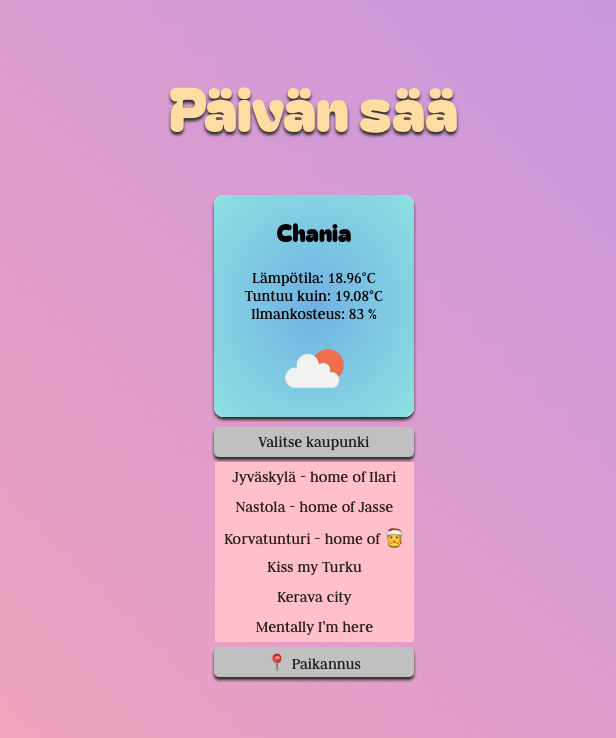

# Päivän sää – Weather App

A small weather app built with vanilla JavaScript that fetches live weather data from the [OpenWeather REST API](https://openweathermap.org/current). You can pick a city from a list or use your current location to see the temperature, the "feels like" temperature, humidity and a matching weather icon. The card's background changes with the weather.

The UI is in Finnish.



## Features

- **City selection** – the city list is loaded from a local JSON file (`cities.json`) and rendered as buttons
- **Geolocation** – the browser's Geolocation API finds the user's coordinates and shows the local weather
- **Live weather data** – a REST API call to OpenWeather by latitude and longitude
- **Dynamic styling** – the background theme (sunny / light / dark) and icon follow the current weather conditions

## How it works

1. `fetchCities()` loads the city list from `cities.json` with the Fetch API.
2. When a city or the location button is clicked, `fetchWeatherData(lat, lon)` sends a GET request to the OpenWeather endpoint:
   ```
   GET https://api.openweathermap.org/data/2.5/weather?lat={lat}&lon={lon}&units=metric&appid={API_KEY}
   ```
3. The JSON response is parsed and `renderWeatherData()` builds the weather card from it.

## Tech

- HTML, CSS and JavaScript (ES modules, async/await, Fetch API)
- [OpenWeather Current Weather API](https://openweathermap.org/current)
- Browser Geolocation API

## Running locally

1. Clone the repository:
   ```bash
   git clone https://github.com/<your-username>/<repo-name>.git
   cd <repo-name>
   ```
2. Get a free API key from [openweathermap.org](https://home.openweathermap.org/users/sign_up).
3. Copy `config.example.js` to `config.js` and add your key:
   ```js
   export const API_KEY = "your_api_key_here";
   ```
   `config.js` is listed in `.gitignore`, so your key stays out of the repository.
4. Serve the folder with a local web server. ES modules and `fetch` don't work from `file://`. For example:
   - VS Code: right-click `weatherapp.html` → **Open with Live Server**

## Project structure

```
├── weatherapp.html      # Page markup
├── weatherapp.css       # Styles and weather themes
├── weatherapp.js        # App logic and API calls
├── cities.json          # City list with coordinates
├── config.example.js    # Template for the API key
└── .gitignore
```

## Background

This started as a course assignment in 2024, and I've since refactored it so the API key is kept out of the repository.

### Assignment details (in Finnish)
Tee sääapplikaatio, joka näyttää käyttäjälle sään valitussa kaupungissa. Käyttäjä voi valita kaupungin listalta tai hakea kaupungin nimen perusteella.
   - #### Vaatimukset

   - Muodosta dropdown tai muu tapa listata kaupungit (nappulat, radio buttonit, jne.) Listaa vähintään 5 kaupunkia.

   - Näytä huomautus, mikäli käyttäjä ei jaa sijaintiaan. Kiinnitä huomiota kuitenkin käytettävyyteen. Käyttäjällä tulee olla oikeus yksityisyyteensä, eikä sijainnin jakamattomuus saa haitata käyttökokemusta tarpeettomasti.

   - Tee sivustosta esteettisesti miellyttävä. Perustele tyylilliset valintasi. Liikaa tyylejä ei tarvitse olla, mutta sivuston tulee olla selkeä ja helppolukuinen.